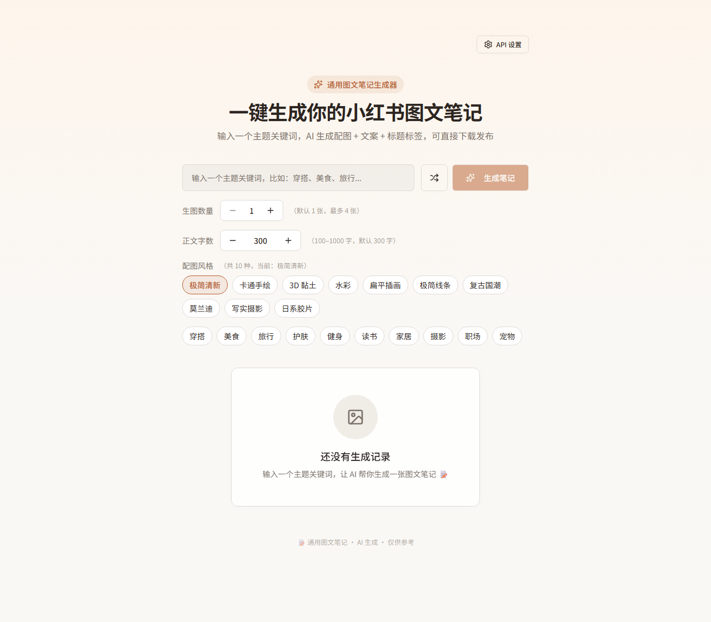

# 通用图文笔记生成器 · XHS Note Generator

输入一个主题关键词，AI 一次性产出 **小红书风格的配图 + 标题 + 正文 + 话题标签**，再合成一张可直接发布的图文笔记图片。

纯前端应用（React + Vite），模型走 **火山方舟（豆包）**：Seedream 负责文生图，豆包文本模型负责文案。API Key 只存在你自己的浏览器 localStorage 或本地 `.env.local`，不经过任何第三方服务器。

<p align="center">
  
</p>

## 功能

| 能力 | 说明 |
| --- | --- |
| 一键生成 | 输入主题词，回车或点「生成」，图片与文案**并行**请求，互不拖累 |
| 多图配图 | 一次 1–8 张 3:4 竖图（1728×2304）；每张单独发请求，避开 Seedream `n` 参数「只出第一张」的问题 |
| 配图风格 | 内置多种封面风格提示词（`NOTE_STYLES`），重生成时沿用原风格，避免风格漂移 |
| 正文字数 | 目标字数可调，模型按 70%–100% 区间写足，靠细节而非注水 |
| 备选标题 | 一次给 3 个：吸睛型 / 干货型 / 共鸣型，卡片上随点随换 |
| 单张重生成 | 只换某一张图：强制「纯白背景 + 原风格不变，仅构图变化」，文案与其它图不动 |
| 配图本地持久化 | 方舟图片链接只有 24 小时有效期 → 生成后自动转存到 `public/notes/<日期>/`，历史记录不再破图 |
| 破图一键修复 | 历史列表检测到加载失败时，可一键批量重新生成并落盘 |
| 历史记录 | 本地保留最近 20 条；点选回填原文案与当时的参数（张数 / 字数 / 风格），编号创建时固定不重排 |
| 导出下载 | canvas 合成 3:4 长图（配图 + 标题 + 正文 + 标签），浏览器直接下载 |
| 随机主题 | 内置选题库抽一个，解决「不知道写什么」 |
| 全程兜底 | 文案接口挂了用本地示例文案、生图失败用占位图，界面不会空白 |
| 可中断 | 生成中可取消，`AbortController` 中断在途请求 |

## 技术栈

- **前端**：React 19 + TypeScript + Vite 8
- **样式**：Tailwind CSS v4 + shadcn/ui（Radix UI）
- **交互**：sonner（toast）、framer-motion、lucide-react
- **模型**：火山方舟 `doubao-seedream-5-0`（文生图）、`doubao-seed-2-0-mini`（文案，JSON 输出）
- **脚手架**：飞书 aPaaS / 秒搭的 Vite + React 模板（`@lark-apaas/*`），模板规范见 [docs/platform-spec.md](docs/platform-spec.md)

## 快速开始

### 1. 安装依赖

```bash
git clone https://github.com/zengweicheng666/xhs-note-generator.git
cd xhs-note-generator
npm install
```

> 仓库未包含模板自带的 `scripts/` 目录，因此 `npm run dev` / `npm run build` 不可用；请用下面的方式启动。

### 2. 配置方舟 API Key（二选一）

**方式 A（推荐）**：启动后在页面右上角「设置」里填 API Key 与模型 ID，存在浏览器 localStorage，改完即生效。

**方式 B**：复制 `.env.example` 为 `.env.local` 再填写：

```bash
cp .env.example .env.local     # Windows: copy .env.example .env.local
```

```dotenv
VITE_ARK_API_KEY=你的方舟APIKey
VITE_ARK_IMAGE_MODEL=doubao-seedream-5-0-260128
VITE_ARK_TEXT_MODEL=doubao-seed-2-0-mini-260428
```

界面设置的 Key 优先于 `.env.local`；`.env.local`、`.env` 都已被 git 忽略，不会入库。

### 3. 启动

```bash
npx vite
# Windows 也可直接双击 start.bat（会先 npm install，再打开浏览器）
```

打开 <http://localhost:8080>。

## 本地代理说明（重要）

`vite.config.ts` 用 Vite 插件实现了 3 个只存在于 dev server 的接口 —— 浏览器不直接持有 Key，也没有跨域问题：

| 接口 | 作用 |
| --- | --- |
| `POST /ark-api/*` → `https://ark.cn-beijing.volces.com/api/v3/*` | 转发方舟请求并注入 `Authorization`：优先取界面里填的 key（`x-ark-key` 头），回退 `.env.local` |
| `GET /ark-img?u=<方舟图片地址>` | 同源转发图片（仅允许 `volces.com` / `volcengine.com`），避免 canvas 跨域污染导致导出黑图 |
| `GET /notes/<日期>/<文件>`、`POST /api/save-image` | 读取 / 保存已落盘的配图，直接读磁盘（绕过 Vite 对 `public/` 的目录缓存），并做路径穿越校验 |

因为这 3 个接口依赖 Node 进程，**纯静态托管（如 GitHub Pages）无法直接生图**；要放到线上使用，需要把它们换成真实的 Serverless / 后端实现。

## 目录结构

```
src/
├── app.tsx                        # 路由（首页 = NoteGeneratorPage）
├── pages/NoteGeneratorPage/
│   ├── NoteGeneratorPage.tsx      # 主流程：图/文并行生成、取消、重生成、批量修复
│   ├── NoteInputSection.tsx       # 关键词、张数、字数、风格、随机主题
│   ├── NoteResultCard.tsx         # 笔记卡片：配图 + 三个标题 + 正文 + 标签 + 导出
│   ├── HistorySection.tsx         # 历史缩略图、破图检测、批量重生成
│   ├── SettingsDialog.tsx         # API Key / 模型 ID 设置
│   └── PublishDialog.tsx          # 发布辅助：复制文案与标签
├── hooks/use-note-history.ts      # 历史记录读写（localStorage，最多 20 条）
├── lib/
│   ├── ark.ts                     # 方舟调用、JSON 容错解析、正文排版规范化
│   ├── image-store.ts             # 配图转存到 public/notes/
│   ├── image-composer.ts          # canvas 合成笔记图、生成占位图
│   ├── settings.ts                # 界面设置读写
│   └── publish.ts                 # 文本拼装（标题 + 正文 + 标签）
├── data/note.ts                   # 记录类型、风格提示词、内置选题、日期编号
└── components/ui/                 # shadcn/ui 组件
public/notes/                      # 运行时生成的配图（已 git 忽略）
docs/platform-spec.md              # 秒搭模板的工程规范（保留原始说明）
```

## 几个实现上的坑（开发备忘）

- **多图**：Seedream 的 `n` / `sequential` 对多数模型不生效，改为「每张各发一次请求」再 `Promise.allSettled` 汇总。
- **图片过期**：方舟返回的是 24 小时 TOS 链接，落盘后前端统一用 `/notes/...` 本地地址，历史记录才稳定。
- **模型 JSON 非法**：正文里的真实换行会破坏 `JSON.parse`，`repairJsonControlChars()` 逐字符转义后再解析，仍失败则回退到文本兜底。
- **正文排版**：模型偶尔输出字面 `\n`（反斜杠 + n），`normalizeNoteText()` 统一换成真实换行并压缩多余空行。

## 已知限制

- 只在本地 dev server 下完整可用（原因见上面的「本地代理说明」）。
- 生成效果取决于所选模型与账号额度；模型侧报错时界面会给兜底结果与 toast 提示。
- 历史记录存在浏览器 localStorage，清缓存即丢；配图在 `public/notes/`，换设备不跟随。

## 我的小红书账号

用这套流程产出的图文笔记都发在这里，欢迎来主页看看、顺便点个关注 👇

> 我在小红书收获了 **19 次赞与收藏**，点击链接或复制口令来看我的主页 >>
> <https://xhslink.cn/o/98XuT7NUpq7>

- 主页直达（短链，手机打开会唤起小红书 App）：<https://xhslink.cn/o/98XuT7NUpq7>
- 想看真实产出效果，可以对着主页的笔记照着本仓库的参数（风格 / 张数 / 字数）复现一遍

## 说明

个人学习 / 使用项目。第三方模型服务（火山方舟）需遵循其服务条款；文案由模型生成，发布前请自行校对。
